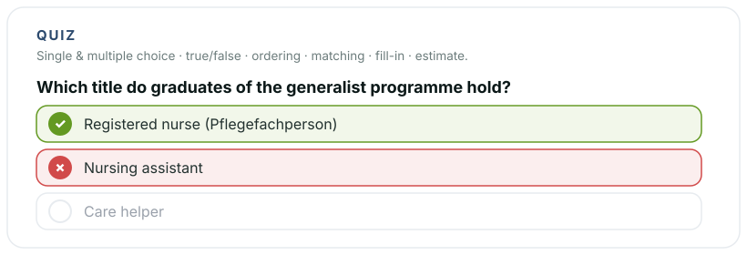

# Reveal-Quiz

[](https://revealjs.com) [](LICENSE)

Interactive exercises for [reveal.js](https://revealjs.com) — **single choice**, **multiple choice**, **true/false**, **ordering**, **matching**, **fill-in-the-blank** and **estimate**. One markup scheme, one `data-type` attribute per exercise. Built for teaching at the board: everything works with a finger on a touch display or smartboard, feedback is shown by colour alone (nothing shifts on the slide), and students can try the same exercises again at home. Standalone (ships its own CSS), colours and labels are easy to theme.

**[Live demo](https://florianloyns.github.io/reveal.js-quiz/demo.html)**

[](https://florianloyns.github.io/reveal.js-quiz/demo.html)

## Installation

**Requires** reveal.js 4.2 or newer. Tested with reveal.js 5.x.

Copy the `quiz` folder into your reveal.js `plugin/` folder — or install from npm.

```console
npm install reveal.js-quiz
```

## Setup

**Regular**

```html
<script src="dist/reveal.js"></script>
<script src="plugin/quiz/quiz.js"></script>
<script>
  Reveal.initialize({ plugins: [ RevealQuiz ] });
</script>
```

**As a module**

```html
<script type="module">
  import Reveal from './dist/reveal.esm.js';
  import RevealQuiz from './plugin/quiz/quiz.esm.js';
  Reveal.initialize({ plugins: [ RevealQuiz ] });
</script>
```

## Usage

Every exercise is a `<div class="quiz" data-type="…">`. Feedback is colour only: green = correct, red = wrong, green outline = correct answer that was missed.

### Single choice

One correct answer, instant feedback on tap. Mark the right option with `data-correct`.

```html
<div class="quiz" data-type="single">
  <div class="quiz-q">Which title do graduates of the generalist programme hold?</div>
  <div class="quiz-options">
    <button class="quiz-opt" data-correct>Registered nurse</button>
    <button class="quiz-opt">Nursing assistant</button>
    <button class="quiz-opt">Care helper</button>
  </div>
</div>
```

### Multiple choice

Several correct answers. The learner selects options and taps **Check**. Missed correct answers are marked with a green outline.

```html
<div class="quiz" data-type="multiple">
  <div class="quiz-q">Which of these are reserved activities?</div>
  <div class="quiz-options">
    <button class="quiz-opt" data-correct>Assessing the care need</button>
    <button class="quiz-opt">Making the beds</button>
    <button class="quiz-opt" data-correct>Steering the care process</button>
  </div>
</div>
```

### True / false

The two buttons are generated for you. For a **single** statement, put `data-answer` on the `.quiz`:

```html
<div class="quiz" data-type="truefalse" data-answer="false">
  <div class="quiz-q">The training contract is signed with the school.</div>
</div>
```

For **several** statements on one slide, use one `.quiz-tf-item` per statement. After an answer the statement holds briefly, then cross-fades to the next — no click needed, and nothing shifts:

```html
<div class="quiz" data-type="truefalse">
  <div class="quiz-tf-item" data-answer="false">
    <div class="quiz-q">The training contract is signed with the school.</div>
  </div>
  <div class="quiz-tf-item" data-answer="true">
    <div class="quiz-q">The probation period lasts six months.</div>
  </div>
</div>
```

### Ordering

Put the items in their **correct** order in the markup (`data-order="1"`, `2`, …) — the plugin shuffles them. To sort, **tap a card** (it lifts), then **tap another card** to swap the two. Tap **Check** to grade, **Reset** to reshuffle. Cards flow in a wrapping grid, so long sequences still fit on one slide.

```html
<div class="quiz" data-type="order">
  <div class="quiz-options">
    <button class="quiz-opt" data-order="1">First step</button>
    <button class="quiz-opt" data-order="2">Second step</button>
    <button class="quiz-opt" data-order="3">Third step</button>
  </div>
</div>
```

### Matching

Sort cards into columns. Name the columns with `data-bins="A|B|C"` on the `.quiz` and give every card the column it belongs to with `data-bin`. The cards start shuffled in a pool above the columns.

To sort, **tap a card** (it lifts and the possible targets are outlined), then **tap a column** to drop it there. Tapping the card a second time cancels the selection; tapping the pool puts a card back. **Check** grades: green = in the right column, red = in the wrong one, orange outline = still in the pool. **Reset** shuffles everything back.

Up to four columns sit side by side; the cards themselves wrap, so a set of a dozen still fits on one slide. Leaving `data-bins` out is allowed — the columns are then collected from the cards' own `data-bin` values, in the order they first appear.

```html
<div class="quiz" data-type="match" data-bins="Nurse|Assistant">
  <div class="quiz-q">Who is allowed to do what? Sort the cards, then Check.</div>
  <div class="quiz-options">
    <button class="quiz-opt" data-bin="Nurse">Assess the care need</button>
    <button class="quiz-opt" data-bin="Nurse">Steer the care process</button>
    <button class="quiz-opt" data-bin="Assistant">Help with washing</button>
    <button class="quiz-opt" data-bin="Assistant">Serve meals</button>
  </div>
</div>
```

### Fill in the blank

Write the text and mark every gap with `<span class="quiz-blank" data-answer="word"></span>`. The word pool is built from the answers, plus optional wrong words in `data-distractors="a|b"` on the `.quiz`. **Tap a word**, then **tap a gap** (or the other way round); tapping a placed word puts it back. Empty gaps are numbered so you can talk about “gap 2” at the board. Gaps are as wide as the longest word, so nothing jumps when a word is dropped in. The text can sit in its own block or directly in `.quiz-q`.

```html
<div class="quiz" data-type="fill-blank" data-distractors="veins|lungs">
  <div class="quiz-q">
    The <span class="quiz-blank" data-answer="heart"></span> pumps blood through the
    <span class="quiz-blank" data-answer="arteries"></span> into the body.
  </div>
</div>
```

### Estimate

A number line for estimation questions. Tap or drag on the scale for a rough value, use **−** / **+** for single steps (hold to repeat, speeding up to tens). **Check** shows the true value on the line, the tolerance band, and whether the guess was too low, too high or a hit. The scale starts at its minimum (`data-start` changes that), so the middle can’t give the answer away.

```html
<div class="quiz" data-type="estimate"
     data-min="0" data-max="200000" data-step="1000"
     data-answer="100800" data-unit="beats" data-tolerance="10%">
  <div class="quiz-q">How often does the heart beat in one day?</div>
</div>
```

`data-tolerance` takes a percentage of the answer (`10%`) or an absolute value (`5000`); without it the global `estimateTolerance` applies.

### Answer order and layout

Single- and multiple-choice answers are **shuffled** every time the exercise is shown (and after a long-press reset), so nobody remembers “the third one” instead of the content. Answers that all start with a number are sorted ascending instead. `data-shuffle="false"` on the `.quiz` keeps the written order, `data-fixed` pins a single answer (e.g. “none of these”) in place. Print keeps the written order.

Short answers (up to `tileMaxChars` characters, 2–8 answers) are shown as equal tiles in a grid, longer ones as a full-width list. Override per exercise with `data-layout="tiles"` or `data-layout="list"`.

Exercises that are too tall for the slide are tightened automatically (spacing first, then scaled down to at most 75 %), leaving `bottomSpace` free for controls.

Every result carries a ✓ / ✗ mark in addition to its colour, so feedback doesn’t rely on colour alone.

## Configuration

All options are optional — for theming the colours and translating the labels.

```js
Reveal.initialize({
  quiz: {
    accent: '#2C4A6E',   // buttons, markers, selection
    ok:     '#639922',   // correct
    bad:    '#D14A4A',   // wrong
    line:   '#E7EBEF',   // resting border
    checkLabel: 'Prüfen',        // the shipped labels are German
    trueLabel:  'Wahr',
    falseLabel: 'Falsch',
    resetLabel: 'Zurücksetzen',
    tfHold: 1200,                // ms a true/false answer stays before cross-fading
    shuffle: true,               // shuffle single/multiple answers
    align: 'left',               // 'left' | 'center'
    tiles: true, tileMaxChars: 24,
    fit: true, bottomSpace: 96,
    locale: 'de-DE',             // number format for estimate
    estimateTolerance: '10%'
  },
  plugins: [ RevealQuiz ]
});
```

| Option | Default | Description |
|---|---|---|
| `accent` | `'#2C4A6E'` | Buttons, order numbers, selection highlight |
| `ok` | `'#639922'` | Correct answers |
| `bad` | `'#D14A4A'` | Wrong answers |
| `line` | `'#E7EBEF'` | Resting option border |
| `checkLabel` | `'Prüfen'` | Label of the check button (multiple / order / match) |
| `trueLabel` | `'Wahr'` | True button label |
| `falseLabel` | `'Falsch'` | False button label |
| `resetLabel` | `'Zurücksetzen'` | Reset button label (order / match) |
| `tfHold` | `1200` | Milliseconds a true/false answer stays before the next fades in |
| `tfProgress` | `'Aussage {i} von {n}'` | Progress label for true/false sets; `false` hides it |
| `shuffle` | `true` | Shuffle single/multiple answers on every show; `data-shuffle="false"` per exercise |
| `align` | `'left'` | `'left'` (full width under the heading) or `'center'` |
| `maxWidth` | `'none'` (`'880px'` when centred) | Maximum width of an exercise |
| `tiles` | `true` | Show short answers as equal tiles |
| `tileMaxChars` | `24` | Longest answer (characters) that still counts as short |
| `fit` | `true` | Tighten exercises that are too tall for the slide |
| `bottomSpace` | `96` | Space (px) kept free at the bottom for controls and arrows |
| `locale` | `'de-DE'` | Number format of the estimate scale |
| `estimateTolerance` | `'10%'` | Default tolerance for estimate (`'10%'` or an absolute number) |
| `estimateLabels` | German | Texts of the estimate feedback: `off`, `low`, `high`, `hit`, `exact`, `truth`, `tolerance`, `solution` |

The shipped labels are German, because that is where the plugin grew up. English, for example:

```js
quiz: { checkLabel: 'Check', trueLabel: 'True', falseLabel: 'False', resetLabel: 'Reset' }
```

## Printing

Open the deck with `?print-pdf`. Every exercise prints with its solution: correct options are marked green with a tick, the others stay readable in grey (they also work in black and white), `order` cards appear in the right sequence, `match` cards sit in their columns and the empty pool disappears. All true/false statements of a slide are listed one below the other, statement left, answer right. In print the exercises run left-aligned across the full content width, like tables and cards.

### Shared print tokens

In print, sizes and colours are read from CSS custom properties. Set them once in your theme and every plugin of the family (quiz, sequence, glossary, quizgrid, hotspot) prints in the same type scale; without a theme each plugin falls back to its own defaults. Explicit plugin options (such as `printFontSize`) still win.

```css
:root{
  --print-pad: 38px 54px 34px;   /* margin of generated pages */
  --print-kicker: 21px;          /* small caps line above the title */
  --print-kicker-track: .28em;
  --print-rule: 2px solid #E7EBEF;
  --print-title: 38px;
  --print-title-after: 20px;
  --print-lead: 22px;            /* question text */
  --print-body: 19px;            /* body text, options, entries */
  --print-meta: 16px;            /* secondary line – the minimum */
  --print-label: 14px;           /* numbers, buttons, column heads */
  --print-lh: 1.4;
  --print-gap: 14px;
  --print-ink: #0B1818; --print-text: #22312F; --print-muted: #5A6A75;
  --print-accent: #2C4A6E;       /* numbers, kicker */
  --print-ok: #639922;           /* reserved for the solution */
  --print-line: #D9E0E7;
}
```

## Changelog

**1.8.3** — Colours aligned with the plugin family: unit and scale labels of `estimate` use the family light grey `#9AA6B2` (was `#9AA8B4`). No visible change.

**1.8.2** — Word cards in the fill-in-the-blank pool are at least as wide as the longest word, so cards and gaps line up.

**1.8.1** — Fill-in-the-blank text can sit directly in `.quiz-q`; it is then set as running text with enough line height that gaps on two lines don’t touch.

**1.5 – 1.8** (summary)

- New exercise type **`fill-blank`**: drop words from a pool into gaps, with optional distractors and numbered empty gaps.
- New exercise type **`estimate`**: number line with − / + steps, tolerance band (percent or absolute), “too low / too high / hit” feedback and the true value shown on the scale; printed with the solution.
- Single/multiple answers are shuffled on every show (`shuffle`, `data-shuffle`, `data-fixed`); purely numeric answers are sorted instead.
- Short answers as equal tiles (`tiles`, `tileMaxChars`, `data-layout`).
- One card style for all exercise types; results marked with ✓ / ✗ in addition to colour; cards left in the pool recede instead of looking wrong.
- Exercises that are too tall are fitted to the slide automatically (`fit`, `bottomSpace`).
- New options `align`, `maxWidth`, `tfProgress`, `locale`, `estimateTolerance`, `estimateLabels`.

**1.4.1** — Print detection unified across the plugin family: every print rule now applies both in the browser print dialog and in reveal’s `?print-pdf` view, so the on-screen preview looks like the PDF; the print view is recognised the same way everywhere (`?print-pdf` or `view: 'print'`).

**1.4.0** — Print layout harmonised with the plugin family: shared print tokens (`--print-*`), left-aligned full-width exercises, readable grey for unselected options, a tick on the correct true/false answer, statement and answer on one line, empty `match` pool hidden, order numbers in the accent colour (green stays reserved for the solution).

**1.3.3** — PDF export (`?print-pdf`) shows the solution: correct options are marked, `order` cards appear in the right sequence, `match` cards sit in their columns, and the action buttons are hidden. True/false statements on one slide are stacked in a compact layout instead of cross-fading. Colour coding survives printing (`print-color-adjust: exact`), even with “background graphics” switched off in the print dialog.

**1.3.1** — the action buttons under a **`match`** exercise are centred.

**1.3.0**

- New exercise type **`match`**: sort cards into named columns — the classic classification exercise, and the one that generates the most discussion at the board because a card can be argued about before it is dropped.
- Cards that were never sorted are marked separately from wrong ones, so "didn't get to it" and "got it wrong" stay distinguishable.

**1.2.0**

- **Long-press a question** (~0.6 s) to reset that exercise — handy when the next group comes up to the board.
- The true/false type holds each answer briefly and then cross-fades to the next statement, so nothing shifts on the slide.
- Feedback is announced to screen readers via `aria-label`.

**1.1.0**

- New exercise type **`order`**: tap two cards to swap them, in a wrapping grid so long sequences fit on one slide.

**1.0.0** — initial release with single choice, multiple choice and true/false.

## Like it?

Star the repo.

## Imprint

Responsible: Florian Loyns — [imprint & privacy notice](https://florianloyns.com/Impressum/) (German)

## License

MIT — see [LICENSE](LICENSE). Thanks to Hakim El Hattab (reveal.js).
